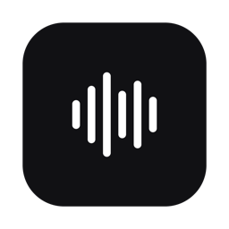

<p align="center">
  
</p>

<h1 align="center">Local Dictation</h1>

<p align="center"><strong>Hold a key, talk, and on-device text lands at your cursor.</strong></p>

<p align="center">
  
  
  
  
</p>

Local Dictation is a push-to-talk dictation app for Apple Silicon Macs. Hold
Right Option, speak, release, and the text is typed where your cursor is. Speech
goes to Cohere Transcribe (4-bit, in MLX), then a small cleanup model,
"S1-mini" by "Superwhisper", tidies it only when the speech was messy. It is
built for how people dictate now: into an AI chat, a Slack thread or a message
box, where you talk, press Enter, and it sends.

> **Free and open source.** Local Dictation is free to use, change and share under the MIT OR Apache-2.0 licence.
> No account, no subscription, no telemetry. Audio and text never leave your Mac; the network is used only for model downloads you start yourself.

<p align="center">
  
</p>

**The speech model is fixed.** Local Dictation always uses Cohere Transcribe
03-2026 in 4-bit MLX. There is no speech-model picker and no cloud provider.
Only the cleanup model is selectable. This keeps the press-to-text path short
and measurable.

## Features

1. **Fast speech-to-text.** A persistent native MLX helper runs Cohere
   Transcribe Q4. The 8.35-second test clip transcribes in about 200 ms hot.
2. **Private and offline.** No account, no telemetry, no network while you
   dictate.
3. **Lands at your cursor, in any app.** Native Cocoa apps get the text through
   Accessibility. Electron apps (VS Code, Slack, browsers, Notion) and terminals
   get a clipboard paste, and your clipboard is restored afterwards.
4. **Guarded cleanup.** Clear speech skips the model and goes straight through.
   Messy speech is offered to S1-mini. If the model truncates, repeats, or
   changes your meaning, deterministic cleanup wins.
5. **Personal dictionary.** Names, brands and tools keep your spelling instead
   of being "corrected" to common words. Add an exact spelling or a
   heard-to-correct replacement in Settings, Dictionary.
6. **Hands-free mode.** Hold the key and tap Space to latch, then talk with
   nothing held down. Tap the key once to stop. No Spacebar? Double-tap the key.
7. **Voice commands.** End with "press enter", "new line" or "press tab" to send
   that key. Say "scratch that" to cancel or "undo that" to revert the last
   dictation.
8. **Edit selected text by voice.** Select a passage, hold Shift plus the key,
   speak an instruction ("make this concise", "translate to Spanish"), and it is
   rewritten in place.
9. **Output formats.** Numbered, bullets, email and code presets reshape a
   dictation when you want structure. Off by default.
10. **Recovery history.** Completed, cancelled, failed and interrupted captures
    keep their audio and text versions on your Mac. Play the audio, compare
    raw, cleaned and output text, copy a version, or recover to the clipboard.

Also included: optional always-on pre-roll (`DICTATE_PREROLL_MS`) so the first
word is never clipped, release tail capture and a warm mic window, a live
waveform pill at the cursor, a menu-bar app with searchable history, a control
socket so Shortcuts, Raycast or a foot pedal can trigger it, and editable system
prompts in plain JSON.

## Requirements

- macOS 14 or later on an Apple Silicon Mac (M1 or later). Intel Macs are not
  supported.
- About 2 GB of disk for the two models, and a network connection for the model
  download.
- To build from source only: full Xcode (the MLX helper builds a Metal resource
  bundle), the Rust stable toolchain, and cmake. `install.sh` offers to install
  Rust and cmake. The first build needs a network connection too (SwiftPM
  fetches packages).
- No other House app is needed.

## Install

### Download

Get the latest DMG from
[Releases](https://github.com/tristan-mcinnis/local-dictation/releases/latest). The file is
`Local-Dictation-<version>-macos-arm64.dmg`, for Apple Silicon Macs on macOS 14 or later.
Open it and drag Local Dictation to Applications.

#### First open (macOS will warn you)

Local Dictation is not notarized. It is a free project, and it has no paid Apple Developer ID. So macOS blocks the first open. Only open it if you downloaded it from the Releases page of this repository.

1. Open the DMG and drag Local Dictation to Applications.
2. Open Local Dictation once. macOS says it cannot verify the app. Click Done.
3. Open System Settings, then Privacy & Security. Scroll down and click Open Anyway next to Local Dictation. Confirm.

If you prefer Terminal, run this once, then open the app:

```bash
xattr -dr com.apple.quarantine "/Applications/Local Dictation.app"
```

Each release is signed ad hoc. So macOS may ask again for permissions such as Accessibility or Microphone after an update. Grant them again when asked.

This build has no models inside it. On first run, the Setup window lists what is
missing. Click Get model for the cleanup model. For the speech model, run this once in
Terminal (no Xcode needed), then quit and reopen the app:

```bash
"/Applications/Local Dictation.app/Contents/Resources/download-models.sh"
```

This free build does not update itself. To update, download the new DMG from Releases
and replace the app. Each release lists a SHA-256 you can check with
`shasum -a 256 -c SHA256SUMS`.

### Build from source

`install.sh` does everything:

```bash
git clone https://github.com/tristan-mcinnis/local-dictation
cd local-dictation
./install.sh
```

It checks prerequisites, downloads both models, builds the native MLX helper and
the Rust app, installs `Local Dictation.app` into `/Applications`, adds a Login
Item, and launches it.

**Models.** `./scripts/download-models.sh` (step 2 of `install.sh`) fetches:

- **Cohere Transcribe 03-2026, 4-bit MLX** (1.5 GB) from the public conversion
  [beshkenadze/cohere-transcribe-03-2026-mlx-4bit](https://huggingface.co/beshkenadze/cohere-transcribe-03-2026-mlx-4bit),
  pinned to one revision, every file checked against its SHA-256.
- **"S1-mini" by "Superwhisper"** (462 MB) from
  [superwhisper/s1-mini-GGUF](https://huggingface.co/superwhisper/s1-mini-GGUF),
  checked against its published SHA-256, with its LICENSE and NOTICE.

The bytes go to `~/Models` (set `LOCAL_MODELS_HOME` to change that), and the
repo's `models/` entries are symlinks to them. If you already have Superwhisper
installed, the script reuses its local copies instead of downloading.

Inside the app, Setup can fetch the cleanup model for you. It cannot fetch the
speech model yet; run the script (a copy sits inside the downloaded app, see
Download), or choose a folder that holds `model.safetensors` and `config.json`.

<details>
<summary><b>Hand it to an AI agent</b> (paste into Claude Code, Codex, or Cursor)</summary>

```text
Set up the "local-dictation" app on this Mac (Apple Silicon) from
https://github.com/tristan-mcinnis/local-dictation:
1. Clone the repo (or use it if we are already inside it).
2. Run ./install.sh. It checks prerequisites, downloads the two models, builds
   "Local Dictation.app", installs it to /Applications, and sets it to launch
   at login. Answer "yes" to prompts about installing Rust or cmake.
Then stop and tell me the one thing you cannot do for me: the app's own Setup
window will list Microphone and Accessibility, and I have to grant both in
System Settings, Privacy and Security myself. The app stays running either way.
Hotkey: hold Right Option to dictate and release to transcribe.
```

</details>

### Permissions

On launch the menu-bar icon appears and a **Setup &
permissions** window lists what is still needed: Microphone, Accessibility and
Models. Turn Accessibility on in System Settings and the hotkey starts working
at once, with no relaunch. A waveform icon with no warning means it is ready.

Local builds sign with the first Apple Development identity in your keychain, so
permission grants survive rebuilds. With no identity the build falls back to
ad-hoc signing, and macOS may ask for Microphone and Accessibility again after
each rebuild. Downloaded releases are ad hoc, so the same applies after an update.

### Making a release

`./scripts/make-dmg.sh` builds the slim app with ad-hoc signing, wraps it in
`Local-Dictation-<version>-macos-arm64.dmg`, writes `SHA256SUMS` and
`RELEASE_NOTES.md`, and checks the image without launching the app. It never
uploads. See [`docs/release/github-release.md`](docs/release/github-release.md).

The repository also holds a pipeline for a Developer ID signed, notarized build
that updates itself through Sparkle 2, as a DMG or a Homebrew cask. It needs a
paid Apple Developer ID and is not in use. It is exercised offline by
`./scripts/release/dry-run.sh`. See
[`docs/release/direct-distribution.md`](docs/release/direct-distribution.md) and
[`docs/release/homebrew.md`](docs/release/homebrew.md).

## Usage

Hold **Right Option**, speak, release. The text lands at your cursor.

For hands-free, hold Right Option and tap **Space** (a short pop confirms), let
go of both keys, and keep talking. Tap Right Option once to stop.

To edit existing text, select it, hold **Shift plus Right Option**, speak an
instruction, and release.

The menu-bar app holds the cleanup-model, hotkey, output-format and cleanup
pickers, dictation history, and prompt and log tools. Settings, Dictionary has a
form for personal terms and heard-to-correct replacements, above a searchable
list of every term. Settings, History groups dictations by day and opens each
record for playback, text versions and recovery.

### Recording feedback and recovery

The compact pill is 94 × 32 points; Standard keeps a 36-point height. Its red
recording dot changes to an X on hover. Click it or press Escape to cancel
before insertion begins. The pill never takes keyboard focus from the target
app.

Live transcript preview shows recognized phrases as you pause. The stages are
Recording, Transcribing, Cleaning up (only when cleanup runs), and Pasting.
Settings, Dictation controls preview, processing detail, size, waveform
sensitivity, cleanup and completion feedback. Always-on pre-roll turns live
preview off.

Settings, History controls audio recovery, its **30-day** default retention, and
separate text retention. An optional size cap can remove older audio sooner.
These choices apply with Apply & Restart. A failed save shows a recovery warning
in the pill and in History.

**Recover to Clipboard** (`⌘R` in the detail window, or `recover <id>` in the
CLI) re-runs saved audio through the warm models, appends the new versions and
copies the result. It never replays spoken commands or pastes into the current
app. **Retry and paste last recording** keeps the older in-memory retry.

Audio is checkpointed off the capture thread and finalized on stop or cancel.
An abrupt crash can lose the newest unsaved tail.

### Subcommands

| Command | What it does |
| --- | --- |
| `daemon` | The push-to-talk daemon, the normal way to use it |
| `toggle`, `start`, `stop`, `cancel` | Drive a running daemon over its control socket (Shortcuts, Raycast, a foot pedal) |
| `fetch-models [dir]` | Report the model stack and fetch what the in-app manifest can |
| `bench [wav]` | Transcribe and clean a WAV, report timings |
| `logs` | Open the daemon log (`~/Library/Logs/Local Dictation/daemon.log`, readable only by you) |
| `ax-check` | Show the Accessibility permission prompt |
| `context-probe` | Print the proper nouns harvested from the focused window |

### Configuration

User config lives in `~/.config/local-dictation/`. The app writes
`settings.json` (model, hotkey, cleanup, output format) and Settings, Dictionary
writes `corrections.json`. Hand-edit `prompts.json` only for custom cleanup and
transform prompts; `prompts.example.json`, `corrections.example.json` and
`dictionary.example.json` show the format. Env vars win over files. Common ones
(the full list is in [`docs/architecture.md`](docs/architecture.md)):

| Var | Effect |
| --- | --- |
| `DICTATE_HOTKEY_KEYCODE` | Push-to-talk key. Default `0x3D` (Right Option) |
| `DICTATE_COHERE_MLX_MODEL_DIR` | Cohere Q4 checkpoint directory |
| `DICTATE_COHERE_MLX_BRIDGE` | Native helper path override |
| `DICTATE_COHERE_LANG` | Decoder language hint (`en` by default) |
| `DICTATE_LLM_MODEL_PATH` | Cleanup model GGUF path (`S1_MODEL_PATH` alias, `GEMMA_MODEL_PATH` deprecated) |
| `DICTATE_FORMAT` | Active output-format preset |
| `DICTATE_QUIET` | Mute audio cues |
| `DICTATE_SHOW_RESULT` | Show the "Landed · N words" pill for 2 s after each dictation (default off) |
| `DICTATE_COMPLETION_SOUND` | Completion cue id (default tight thud) |
| `DICTATE_START_SOUND` | Start cue id (default rising pair) |
| `DICTATE_NO_MUTE` | Do not mute other audio during capture |
| `DICTATE_LOG_TEXT` | Debug only: write dictated text into the log. Off by default |

### Optional integration

The daemon publishes a small JSON manifest of its commands to
`~/Library/Application Support/House/commands/`, so a House launcher can list
and trigger them. Nothing else reads it, and Local Dictation works the same
without it.

### Performance

Measured on an Apple M5 after warm-up with `testdata/dictation_sample.wav`
(8.35 seconds of speech):

| Stage | Hot latency |
| --- | ---: |
| Cohere Transcribe Q4 through MLX | about 196–220 ms |
| S1-mini attempt on the fixture | about 6–70 ms |
| Combined inference fixture | about 207–270 ms |

Native Accessibility insertion takes about 5 ms. Electron apps add about 185 ms
of clipboard paste settle time. Run
`cargo run --release --features full -- bench testdata/dictation_sample.wav` for
your own numbers.

### How it compares

| | Local Dictation | Apple Dictation | Cloud (Wispr Flow) | Local apps (Superwhisper, MacWhisper) |
| --- | --- | --- | --- | --- |
| Runs fully on-device | Yes | Yes | No | Yes |
| Latency, clear speech | about 200 ms | varies | network-bound | varies |
| Cleanup that keeps your words | Yes | No | Yes | Some |
| Edit selected text by voice | Yes | No | Partial | Rare |
| Editable prompts | Yes (JSON) | No | No | No |
| Price | Free | Free | Subscription | Paid or freemium |
| Account or signup | None | None | Usually | Varies |
| One-click install | Download, plus a first-open step and a model download | Yes | Yes | Yes |

If you want zero setup and a maintained app, the others win. If you want low
latency and full control of the model's behaviour in a text file, this is for
you.

### Trade-offs

- The speech model is fixed. Cohere is multilingual (14 languages), but the
  prompts and eval corpus are English-first.
- S1-mini is guarded; a failed quality check falls back to deterministic text.
- Recording is bounded by the key hold, not silence detection.
- macOS 14 or later, Apple Silicon only.

## Privacy

- **Read:** microphone audio while you hold the key (and a short rolling buffer
  if you turn on pre-roll); the focused text field's role and nearby text
  through Accessibility, to choose how to insert and to pick up proper nouns for
  cleanup; the clipboard, saved and restored around a paste fallback.
- **Sent:** nothing while you dictate. The network is used only when you start
  a model download (Setup's Get model, `fetch-models`, or
  `download-models.sh`), which talks to huggingface.co. The free download build
  never checks for updates.
- **Stored, on your Mac only:** dictation history in `history.db`, recovery
  audio (30 days by default) and text versions, your settings, dictionary and
  corrections in `~/.config/local-dictation/`, and a daemon log that records
  timings and text lengths, never what you said (unless you set
  `DICTATE_LOG_TEXT=1`).

## Build from source

```bash
# Toolchain (one-time)
rustup update stable
xcode-select --install
brew install cmake

# Models (about 2 GB, once)
./scripts/download-models.sh

# Build and run from a terminal
cargo build --features full --release
native/cohere-mlx/build.sh
./target/release/fast-dictate-backend daemon

# Or build the .app bundle
./scripts/build-app.sh --install        # build, copy to /Applications, login item, launch
./scripts/build-app.sh --slim           # app without models (supply them separately)
./scripts/build-app.sh --bundle-models --dmg
./scripts/make-dmg.sh                   # the GitHub release DMG (slim, ad hoc, arm64)
```

Tests:

```bash
cargo test                   # core unit and integration tests, plus the scrub gate; no models needed
cargo test --features full   # adds the menu bar, history, injector and cleaner suites
native/cohere-mlx/test.sh    # Swift bridge protocol tests
scripts/release/dry-run.sh   # Developer ID release pipeline, offline
cargo run --release --features cleaner --example s1_mini_eval   # needs the models
```

Architecture, the bridge protocol, config precedence and every env var are in
[`docs/architecture.md`](docs/architecture.md).

## Part of House

Local Dictation is one of a small family of free, local-first Mac tools that share one design system.

| App | What it does |
|---|---|
| [Quick Launch](https://github.com/tristan-mcinnis/quick-launch) | Keyboard-first launcher and instant AI overlay. |
| [**Local Dictation**](https://github.com/tristan-mcinnis/local-dictation) | Hold a key, talk, and on-device text lands at your cursor. |
| [Local TTS](https://github.com/tristan-mcinnis/local-tts) | Fast on-device voice cloning and text-to-speech. |
| [Local Models](https://github.com/tristan-mcinnis/local-models) | One local daemon that serves a fleet of small models to every app. |
| [Usage](https://github.com/tristan-mcinnis/usage-menubar) | One menu-bar gauge for every AI subscription and API key. |
| [RTI](https://github.com/tristan-mcinnis/rti) | Meeting recorder with live transcription and a real-time copilot. |

Local Dictation runs both of its models inside its own process rather than
through Local Models, on purpose: a daemon round trip would sit on the
press-to-text path. By default it shares the same `~/Models` folder for the
weights.

## Credits

Local Dictation stands on other people's work:

- **Cohere Labs** for [Cohere Transcribe 03-2026](https://huggingface.co/CohereLabs/cohere-transcribe-03-2026) (Apache-2.0), and **beshkenadze** for the [4-bit MLX conversion](https://huggingface.co/beshkenadze/cohere-transcribe-03-2026-mlx-4bit) the install script downloads.
- **Superwhisper** for the cleanup model, ["S1-mini" by "Superwhisper"](https://huggingface.co/superwhisper/s1-mini) (Apache-2.0 with a naming term), and **Alibaba Cloud** for its base, [Qwen3-0.6B](https://huggingface.co/Qwen/Qwen3-0.6B).
- **Prince Canuma** and contributors for [mlx-audio-swift](https://github.com/Blaizzy/mlx-audio-swift), which carries the Cohere Transcribe port, and **Apple's ml-explore team** for [MLX](https://github.com/ml-explore/mlx) and [MLX Swift](https://github.com/ml-explore/mlx-swift).
- **The ggml authors** for [llama.cpp](https://github.com/ggml-org/llama.cpp), and **utilityai** for the [llama-cpp-rs](https://github.com/utilityai/llama-cpp-rs) bindings.
- The authors of [cpal](https://github.com/RustAudio/cpal), [objc2](https://github.com/madsmtm/objc2), [rusqlite](https://github.com/rusqlite/rusqlite) and SQLite, [tokio](https://tokio.rs), [serde](https://serde.rs), and the other crates and Swift packages listed in the notices.
- [Sparkle](https://github.com/sparkle-project/Sparkle) for in-app updates in release builds.
- **Kenney Vleugels** ([kenney.nl](https://kenney.nl)) for eight CC0 completion sounds.

Every model, package and crate, with its licence and copyright line, is in
[THIRD_PARTY_NOTICES.md](THIRD_PARTY_NOTICES.md). The built app carries that file
in `Contents/Resources`.

## License

Dual-licensed under MIT OR Apache-2.0, at your option. See
[LICENSE-MIT](LICENSE-MIT) and [LICENSE-APACHE](LICENSE-APACHE).
Copyright (c) 2026 Tristan McInnis.

Model weights are not part of this repository. They are downloaded from their
publishers and keep their own licences (both Apache-2.0; S1-mini adds a naming
term).
