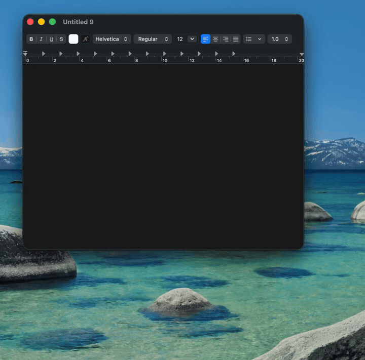

# local-dictation

Fast, private, on-device dictation for one Apple Silicon Mac. Hold a key, talk,
release, and the text lands at your cursor. Everything runs locally: Cohere
Transcribe Q4 in native MLX, then S1-mini for guarded cleanup.

Built for how people actually dictate now: into an AI chat, a Slack thread, a message box. The text drops in at the cursor, so you talk, press Enter, and it sends. The whole point is speed, so the cleanup model only runs when your speech is actually messy. Clear speech goes straight through.

This branch is intentionally software-of-one. The speech model is fixed (only
the cleanup model is selectable), and there are no cloud providers, account,
subscription, or runtime telemetry.


<p align="center">
  
</p>

## Features, in order of impact

1. **Fast Cohere MLX.** The old ONNX/Core ML path fell back to CPU. The native
   persistent MLX helper runs the 8.35-second fixture in about 198–220 ms hot.
2. **Fully private and offline.** Audio and text never leave your Mac. No account, no telemetry, no network while you dictate. The one time the app uses the network is a model download you start yourself, from Setup & permissions.
3. **Lands at your cursor, in any app.** Dictate into any text field or chat box and press Enter to send. Works in native Cocoa apps directly, and falls back to clipboard paste for Electron apps (VS Code, Slack, browsers, Notion).
4. **Guarded S1-mini cleanup.** Clean speech skips generation. Messy speech is
   offered to S1-mini; deterministic cleanup and content/runaway guards win if
   the model truncates, repeats, or changes intent.
5. **Personal dictionary.** Your names, brands, and tools (Todoist, Pencil, macOS) are kept as you mean them instead of being "corrected" to common words. Add an exact spelling or a heard→correct replacement directly in Settings → Dictionary; Apply & Restart makes it active.
6. **Hands-free mode.** Hold the key and tap Space to latch, then talk with nothing held down. Tap the key once to stop. Good for long thoughts. No Spacebar? Double-tap the key to latch instead.
7. **Voice commands.** End an utterance with "press enter", "new line", or "press tab" to emit the keystroke. Say "scratch that" to cancel, or "undo that" to revert the last dictation.
8. **Transform selected text by voice.** Select a passage, hold Shift plus the key, speak an instruction ("make this concise", "translate to Spanish"), and it rewrites in place.
9. **Output formats.** Numbered, bullets, email, and code presets reshape a dictation when you want structure. Off by default, picked from the menu bar.
10. **Recovery history.** Completed, cancelled, failed, and interrupted captures keep their available audio and text versions locally. Open a history row to play the audio, compare raw/cleaned/output versions, copy a version, or Recover to Clipboard. Audio stays for 30 days by default; text has its own retention setting.

Also included: optional always-on pre-roll (`DICTATE_PREROLL_MS`) so the first word is never clipped, release tail-capture and a warm mic window on by default, a live waveform pill at the cursor, a menu-bar app with searchable history, a control socket so Shortcuts / Raycast / a foot pedal can trigger it, and editable system prompts in plain JSON.

## Install

Requires macOS 14 or later on Apple Silicon. Model bytes are never committed.
`./scripts/download-models.sh` prepares the stack: it downloads the cleanup
model, "S1-mini" by "Superwhisper", from Hugging Face and verifies its SHA-256
(a local Superwhisper install is used instead when present, since the bytes are
identical). The app can fetch that same cleanup model for itself from Setup &
permissions, against the same published digest.

The Cohere Q4 speech model still comes from a local 4-bit MLX checkpoint: no
public conversion exists to download, so that part is not yet a clean-room
install for a stranger. Setup & permissions says so and offers a folder picker
for a checkpoint you already have. The app never invents a download.

`download-models.sh` keeps the model bytes in the shared `~/Models` store (the
repo's `models/` entries are symlinks into it), but both models run in-process
inside this app. Local Dictation does not send audio or text through the Local
Models daemon. This is deliberate: a daemon round trip would sit on the
press-to-text path, so dictation stays in-process for latency, and the house
`vision.md` names it as the exception to the one local serving layer.

Local builds use an available Apple Development signing identity. Keep the same identity across updates to preserve macOS permission grants.

Launch it. The menu bar icon appears straight away, and a **Setup &
permissions** window opens listing what is still needed: Microphone,
Accessibility and Models. Turn Accessibility on in System Settings and the
hotkey starts working immediately, with no relaunch. A waveform icon with no
warning means it is ready.

### Released builds

A published build is signed with a Developer ID Application certificate, runs
under the hardened runtime, is notarized and stapled, and updates itself in-app
through Sparkle 2. It can be installed two ways:

- **Direct download** — the notarized DMG from the releases page; the app checks
  an HTTPS appcast and installs signed updates itself.
- **Homebrew** — `brew install --cask <tap>/local-dictation`. The cask installs
  the same app; Sparkle still owns in-app updates.

Neither path is published yet. The pipeline that produces both is owned by this
repository and is exercised offline by `./scripts/release/dry-run.sh`; the
remaining work is credentialed, human-gated packaging. See
[`docs/release/direct-distribution.md`](docs/release/direct-distribution.md) and
[`docs/release/homebrew.md`](docs/release/homebrew.md). Public-release readiness,
including the open blockers, is recorded in
[`docs/public-release-audit-20260921.md`](docs/public-release-audit-20260921.md).

**Build from source.**

```bash
git clone https://github.com/tristan-mcinnis/local-dictation
cd local-dictation
./install.sh
```

`install.sh` checks prerequisites, prepares the personal model links/conversion,
builds the native MLX helper and Rust app, installs it, and starts it.

If no signing identity is available, the build script falls back to ad-hoc signing; that fallback can require Microphone and Accessibility permission again.

<details>
<summary><b>Run from a terminal, or build the app yourself</b></summary>

```bash
# Toolchain (one-time)
rustup update stable
xcode-select --install
brew install cmake

# Code plus models
git clone https://github.com/tristan-mcinnis/local-dictation
cd local-dictation
./scripts/download-models.sh

# Build and run
cargo build --features full --release
./target/release/fast-dictate-backend daemon

# Or build the .app bundle
./scripts/build-app.sh --install      # build, copy to /Applications, login item, launch
./scripts/build-app.sh --bundle-models --dmg
```

</details>

<details>
<summary><b>Hand it to an AI agent</b> (paste into Claude Code, Codex, or Cursor)</summary>

```text
Set up the "local-dictation" app on this Mac (Apple Silicon) from
https://github.com/tristan-mcinnis/local-dictation:
1. Clone the repo (or use it if we are already inside it).
2. Run ./install.sh. It checks prerequisites, prepares the local model links, builds
   "Local Dictation.app", installs it to /Applications, and sets it to launch
   at login. Answer "yes" to prompts about installing Rust or cmake.
Then stop and tell me the one thing you cannot do for me: the app's own Setup
window will list Microphone and Accessibility, and I have to grant both in
System Settings, Privacy and Security myself. The app stays running either way.
Hotkey: hold Right Option to dictate and release to transcribe.
```

</details>

## Using it

Hold **Right Option**, speak, release. The text lands at your cursor.

For hands-free, hold Right Option and tap **Space** (a short pop confirms), let go of both keys, and keep talking. Tap Right Option once to stop.

To edit existing text, select it, hold **Shift plus Right Option**, speak an instruction, and release.

The menu-bar app holds the cleanup-model, hotkey, output-format, and cleanup pickers, dictation history, and prompt and log tools. Settings → Dictionary provides a plain-language form for adding personal terms and deterministic heard→correct replacements without editing JSON, above a searchable list of every term: click a row to edit it, use the trash chip to remove it. Settings → History groups dictations by day and opens each record for playback, text versions, and recovery. Copy all copies the saved text in the current search; deleting a record removes its saved audio and versions.

## Recording feedback and recovery

The compact pill is 94 × 32 points; Standard keeps a 36-point height. Its red
recording dot changes to an X on hover. Click it or press Escape to cancel
before insertion begins. The pill stays out of the target app's keyboard focus.

Live transcript preview shows recognized phrases as you pause. The stages are
Recording → Transcribing → Cleaning up (when cleanup actually runs) → Pasting.
Fast stages pass without an artificial delay. Settings → Dictation controls
preview, processing detail, size, waveform sensitivity, cleanup, and optional
completion feedback. Waveform sensitivity changes only the visual response.
Always-on pre-roll disables live preview; the saved preview choice is retained.

Settings → History controls audio recovery, its **30-day** default retention,
and separate text retention. Audio has no additional size cap by default; an
optional cap can remove older audio sooner. These choices apply with Apply &
Restart. Saving failures produce a recovery warning in the pill and History.

Open a record to play/stop its audio, inspect each text version, and copy it.
**Recover to Clipboard** (`⌘R` in the detail window, or `recover <id>` in the CLI)
uses saved audio with the warm transcription and optional cleanup models. It
appends new versions and copies the result. It does not replay spoken commands
or paste into the current app. The separately named **Retry and paste last
recording** retains the older in-memory retry behavior.

Audio is checkpointed off the capture thread and finalized on stop/cancel.
Graceful shutdown drains queued writes. An abrupt crash can lose the newest
uncheckpointed tail; an existing synchronous ASR call can delay a checkpoint.
Recovery includes recordings made after this feature is installed, not audio
from older text-only history.

## Performance

Measured on an Apple M5 after warm-up with `testdata/dictation_sample.wav`
(8.35 seconds of speech):

| Stage | Hot latency |
| --- | ---: |
| Cohere Transcribe Q4 through MLX | about 198–220 ms |
| S1-mini attempt on the fixture | about 6–70 ms |
| Combined inference fixture | about 207–270 ms |

Native AX insertion remains about 5 ms. Clipboard fallback is measured
separately because Electron applications can add substantially more latency.
Run `cargo run --release --features full -- bench testdata/dictation_sample.wav`
for current-machine numbers.

## Models

| Model | Size | Role |
| --- | ---: | --- |
| [Cohere Transcribe 03-2026](https://huggingface.co/CohereLabs/cohere-transcribe-03-2026) Q4 MLX, by Cohere Labs | about 1.5 GB | Fixed speech-to-text model |
| [S1-mini](https://huggingface.co/superwhisper/s1-mini) Q4_K_M, by Superwhisper | about 462 MB | Fixed cleanup model |

Both models are open weights under Apache-2.0. S1-mini adds a naming clause: the
model keeps the name **"S1-mini" by "Superwhisper"** wherever it is used. Local
Dictation loads the released weights unmodified and supplies its own prompts and
guards. GGUF builds are published at
[superwhisper/s1-mini-GGUF](https://huggingface.co/superwhisper/s1-mini-GGUF);
the persistent llama.cpp worker loads one of them.

The Cohere setup script re-keys Safetensors metadata for the public
`mlx-audio-swift` module; tensor bytes are unchanged, so the result is a derived
work of the Apache-2.0 model.

Full attribution for models, native packages and crates is in
[THIRD-PARTY-NOTICES.md](THIRD-PARTY-NOTICES.md).

## Compared to the alternatives

| | local-dictation | Apple Dictation | Cloud (Wispr Flow) | Local apps (Superwhisper, MacWhisper) |
| --- | --- | --- | --- | --- |
| Runs fully on-device | Yes | Yes | No | Yes |
| Latency, clear speech | about 150 ms | varies | network-bound | varies |
| Cleanup that keeps your words | Yes | No | Yes | Some |
| Edit selected text by voice | Yes | No | Partial | Rare |
| Editable prompts | Yes (JSON) | No | No | No |
| Price | Free | Free | Subscription | Paid or freemium |
| Account or signup | None | None | Usually | Varies |
| One-click install | No (build or ad-hoc app) | Yes | Yes | Yes |

If you want zero setup and a maintained app, the others win. If you want the lowest latency and full control over the model's behavior in a text file, this is for you.

## Configuration

User config lives in `~/.config/local-dictation/`. The app writes `settings.json` (model, hotkey, cleanup, output format) and Settings → Dictionary writes `corrections.json`. Hand-edit `prompts.json` only for custom cleanup and transform prompts. Env vars win over files. Common ones
(the full list is in `docs/architecture.md`):

| Var | Effect |
| --- | --- |
| `DICTATE_HOTKEY_KEYCODE` | Push-to-talk key. Default `0x3D` (Right Option) |
| `DICTATE_COHERE_MLX_MODEL_DIR` | Converted Cohere Q4 checkpoint directory |
| `DICTATE_COHERE_MLX_BRIDGE` | Native helper path override |
| `DICTATE_COHERE_LANG` | Decoder language hint (`en` by default) |
| `DICTATE_LLM_MODEL_PATH` | Cleanup-LLM GGUF path override (`S1_MODEL_PATH` alias, `GEMMA_MODEL_PATH` deprecated) |
| `DICTATE_FORMAT` | Active output-format preset |
| `DICTATE_QUIET` | Mute audio cues |
| `DICTATE_SHOW_RESULT` | Show the "Landed · N words" pill for 2 s after each dictation (default off) |
| `DICTATE_COMPLETION_SOUND` | Completion cue id for the sound that plays when text lands (default tight thud) |
| `DICTATE_START_SOUND` | Start cue id for the sound that plays when recording starts (default rising pair) |
| `DICTATE_NO_MUTE` | Do not mute other audio during capture |
| `DICTATE_LOG_TEXT` | Debug only: write dictated text into the log. Off by default; the log holds timings and lengths |

## Subcommands

| Command | What it does |
| --- | --- |
| `daemon` | The push-to-talk daemon, the real way to use this |
| `toggle`, `start`, `stop`, `cancel` | Drive a running daemon over its control socket (Shortcuts, Raycast, a foot pedal) |
| `fetch-models [dir]` | Report the model stack and fetch what the manifest can |
| `bench [wav]` | Transcribe and clean a WAV, report timings |
| `logs` | Open the daemon log (`~/Library/Logs/Local Dictation/daemon.log`, readable only by you; it records timings and text lengths, never what you said) |
| `ax-check` | Surface the Accessibility permission prompt |
| `context-probe` | Print the proper nouns harvested from the focused window |

## Trade-offs

* Cohere is multilingual, but the personal prompt/eval corpus is English-first.
* S1-mini is guarded; failed quality checks fall back to deterministic text.
* Electron apps add about 185 ms (clipboard paste settle time). Native apps inject in about 5 ms.
* Recording is bounded by key hold, not silence detection.
* macOS 14 or later, Apple Silicon only.

## Tests

```bash
cargo test                 # core unit and integration tests, no models needed
cargo test --features full # adds the menubar, history, injector, and cleaner suites
native/cohere-mlx/test.sh
cargo run --release --features cleaner --example s1_mini_eval
```

## License

Dual-licensed under MIT OR Apache-2.0, at your option. See [LICENSE-MIT](./LICENSE-MIT) and [LICENSE-APACHE](./LICENSE-APACHE).

Models are not redistributed here. This personal build refers to locally
installed model files; check their terms before broader distribution.

## Acknowledgements

Built with [Cohere Transcribe](https://huggingface.co/CohereLabs/cohere-transcribe-03-2026),
[mlx-audio-swift](https://github.com/Blaizzy/mlx-audio-swift),
[MLX Swift](https://github.com/ml-explore/mlx-swift),
[llama.cpp](https://github.com/ggml-org/llama.cpp),
[Sparkle](https://github.com/sparkle-project/Sparkle), `cpal`, `objc2`, and `rusqlite`.

---

Keywords: macOS dictation, Cohere Transcribe, S1-mini, MLX, on-device,
offline, private, push to talk, Apple Silicon, Rust.
